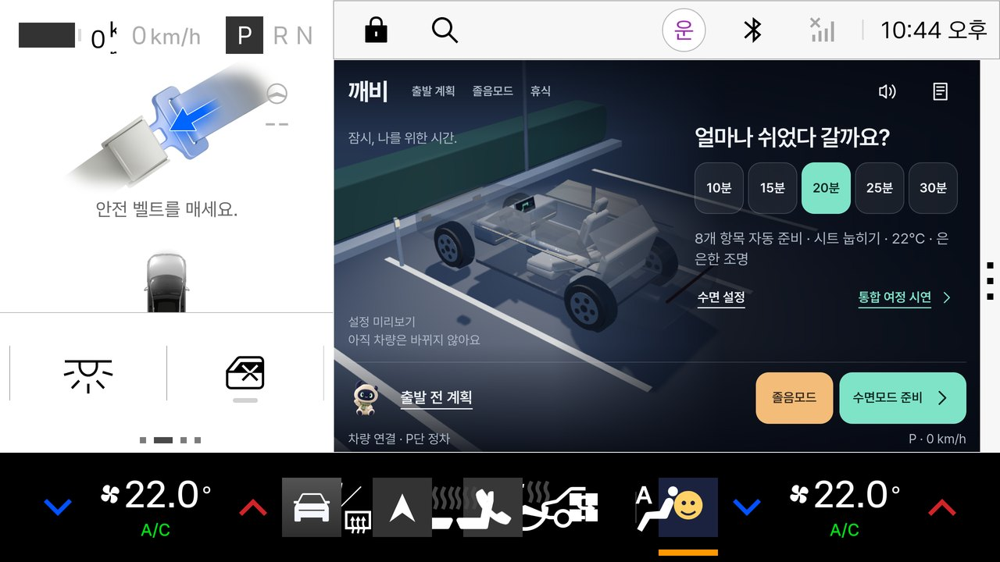
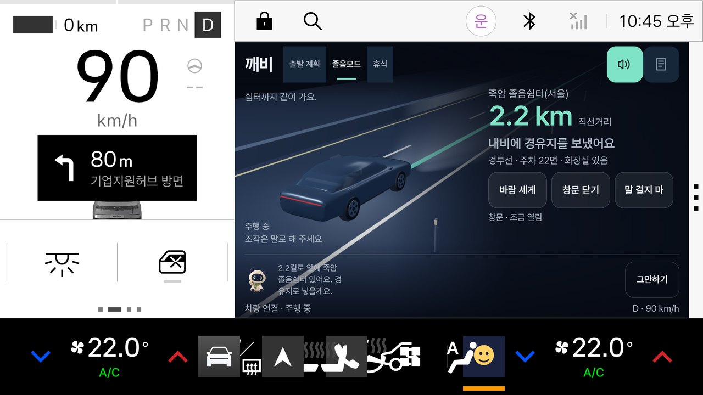
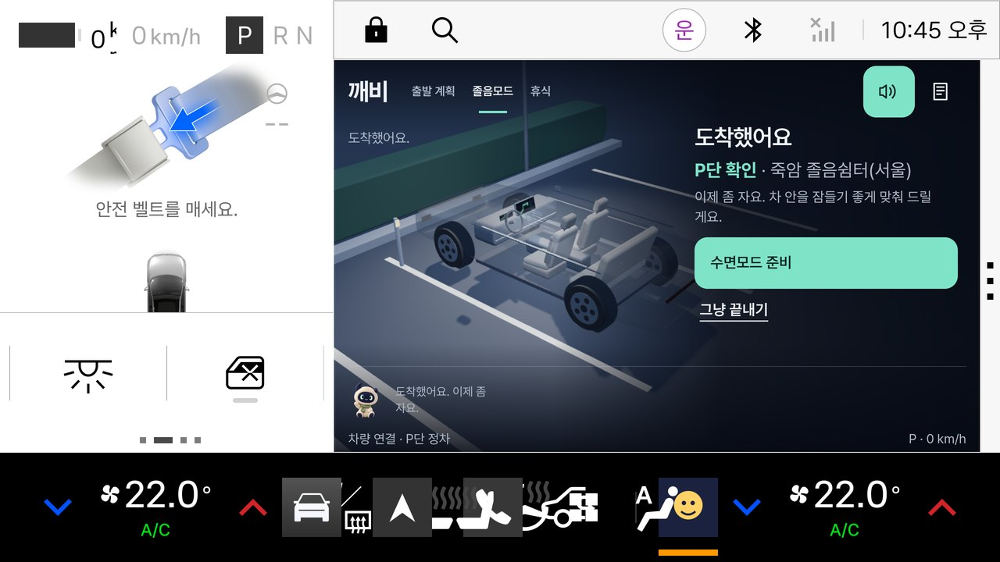
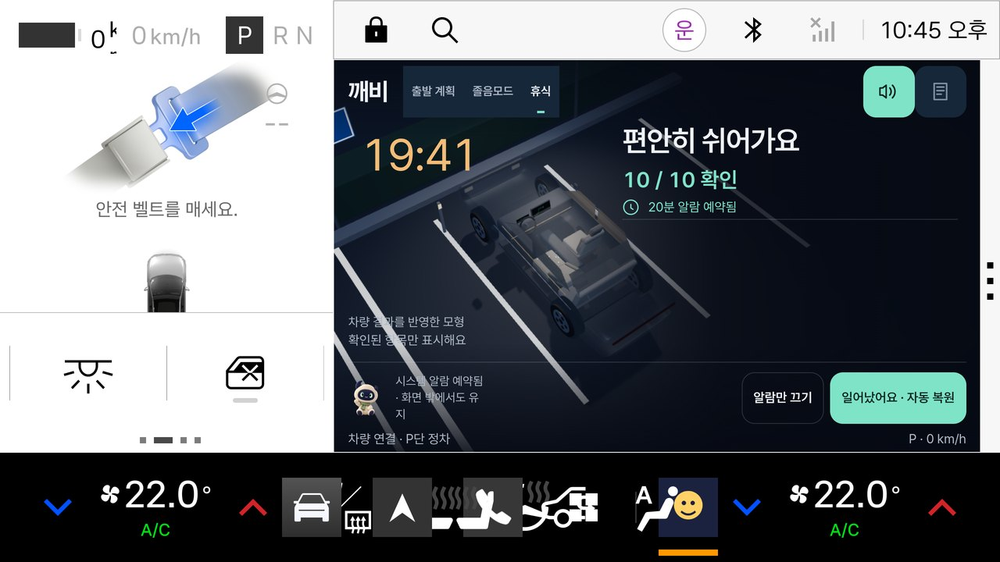
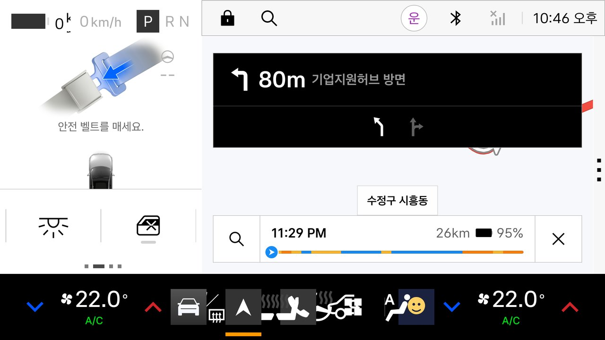
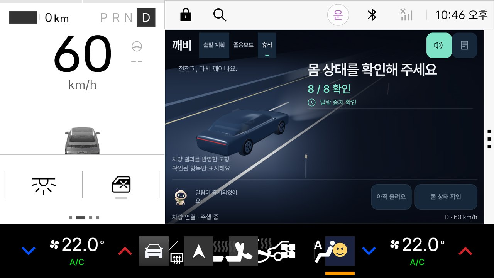

# 깨비 테스트 가이드

Pleos Connect Emulator에서 깨비의 전체 흐름을 10분 안에 따라 해 볼 수 있게 정리했습니다. 졸음 호출 → 쉼터 안내 → 도착 → 수면 환경 → 기상·복원 → 원래 목적지 복귀 순서입니다.

## 1. 준비

- Pleos Connect Emulator **v2.1.0**, Android 14(API 34). [공식 설치 안내](https://document.pleos.ai/docs/connect/guide/getting-started/application-development/setup-connect-sdk-emulator)대로 AVD를 만들고 **Cold boot**로 켭니다. Quick boot에서는 차량 신호(VHAL)를 쓸 수 없습니다.
- `adb`가 PATH에 있어야 합니다.
- 차량 신호는 공식 **Pleos Connect Virtual Console**로 바꿉니다. 아래 스크립트가 `adb forward tcp:8088 tcp:8088`을 대신 실행하니, 브라우저에서 `http://127.0.0.1:8088/`을 열어 두면 기어·속도·창문·조명·공조 값이 바뀌는 모습을 함께 볼 수 있습니다. 가상 콘솔이 연결돼 있어야 에뮬레이터의 공조 값을 읽을 수 있습니다.

## 2. 설치와 시작

저장소 루트에서 실행합니다.

```sh
sh judge/kkaebi-demo.sh setup          # macOS / Linux
.\judge\kkaebi-demo.ps1 setup          # Windows PowerShell
```

APK를 설치하고, P단·0km/h로 맞추고, 위치를 경부선 죽암 졸음쉼터 2km 앞으로 옮기고, 내비 목적지를 서울역으로 넣습니다. 처음 실행하면 권한 창이 네 번 뜹니다(위치, 마이크, 알림, 차량 속도). 모두 **허용**을 누릅니다. 거절했다면 홈의 **권한 허용**으로 다시 요청할 수 있습니다.



하단에 `차량 연결 · P단 정차`, 오른쪽 아래에 `P · 0 km/h`가 보이면 준비가 끝난 것입니다.

## 3. 졸릴 때 (주행 중)

```sh
sh judge/kkaebi-demo.sh drive          # D단 90km/h
```

1. 상단 **졸음모드** → **졸려요 · 쉼터 찾기**를 누릅니다. 마이크를 연결했다면 "깨비야, 졸려"라고 말해도 됩니다(에뮬레이터 Extended Controls > Microphone).
2. 깨비가 가장 가까운 **죽암 졸음쉼터(2.2km)**를 찾아 내비 경유지로 보내고 음성으로 알려 줍니다. 내비 화면이 앞으로 나오면 앱 목록에서 깨비를 다시 엽니다.
3. 가는 동안 **바람 세게**, **창문 조금 열기**, **말 걸지 마**를 눌러 봅니다. 창문을 열면 가상 콘솔의 운전석 창문 값이 0 → 10%로 바뀝니다.



## 4. 쉼터 도착과 수면 환경

```sh
sh judge/kkaebi-demo.sh arrive         # 쉼터 위치, 0km/h, P단
```

1. 화면이 **도착했어요**로 바뀌고, 주행 중에 열었던 창문은 원래대로 닫힙니다.
2. **수면모드 준비** → 동의 체크 → **수면 환경 준비**를 누릅니다.
3. 알람을 예약한 뒤 시트 눕히기, 블라인드, 실내 조명, 공조(온도·풍량), 시트 통풍, 창문을 차례로 맞춥니다. 각 항목이 3D 모형과 목록에서 진행 → 확인으로 바뀝니다.




## 5. 기상과 다시 출발

1. 알람(기본 20분)을 기다리지 않아도 됩니다. **일어났어요 · 자동 복원**을 누르면 알람을 끄고 바꿨던 설정을 원래 값으로 되돌립니다.
2. 동시에 내비에서 쉼터 경유지를 빼고 **원래 목적지(서울역)로 경로를 다시 잡습니다.** 내비 화면이 앞으로 나옵니다.
3. 깨비로 돌아와 **몸 상태 확인**을 누른 뒤 다시 출발합니다.

```sh
sh judge/kkaebi-demo.sh resume         # D단 60km/h
```




## 6. 평소 휴식 (주차 중 낮잠)

졸음모드 없이도 쓸 수 있습니다. P단에서 홈의 휴식 시간(10~30분)을 고르고 **수면모드 준비**를 누르면 같은 수면 환경과 알람이 준비됩니다.

## 7. 짧게 보기

홈의 **통합 여정 시연**은 같은 흐름을 150초로 줄인 시나리오입니다. 차량을 제어하지 않습니다.

## 참고

- 수면 환경 제어는 P단·0km/h에서만 동작합니다. 주행으로 바꾸면 진행 중인 변경을 멈추고 화면에 알립니다.
- 시트 각도와 블라인드는 가상 콘솔에 카드가 없어 깨비 화면의 진행 상태로 확인합니다.
- 다른 위치에서 시험하려면 `adb emu geo fix <경도> <위도>`로 옮깁니다. 지금 APK에는 경부·중부·영동선 졸음쉼터 10곳(죽암, 옥산, 신갈, 안성, 망향, 하남, 문막, 덕평, 서울 톨게이트, 언양)이 들어 있고, 그중 가장 가까운 곳을 고릅니다. 예: 하남 졸음쉼터 앞 `adb emu geo fix 127.233 37.479`.
- 스크립트 단계: `setup`, `drive`, `arrive`, `resume`, `park`, `status`. 에뮬레이터가 여러 대면 `ANDROID_SERIAL`로 지정합니다.
