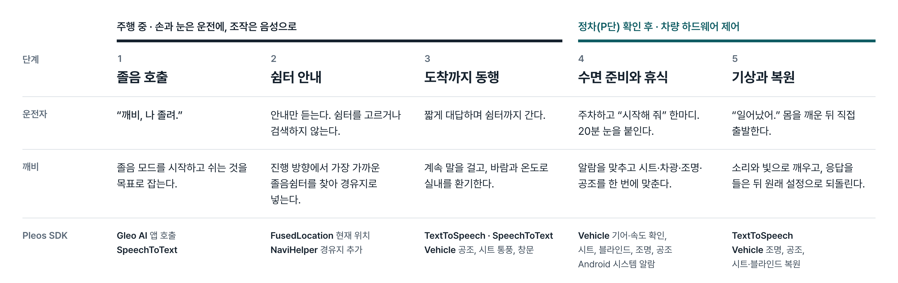
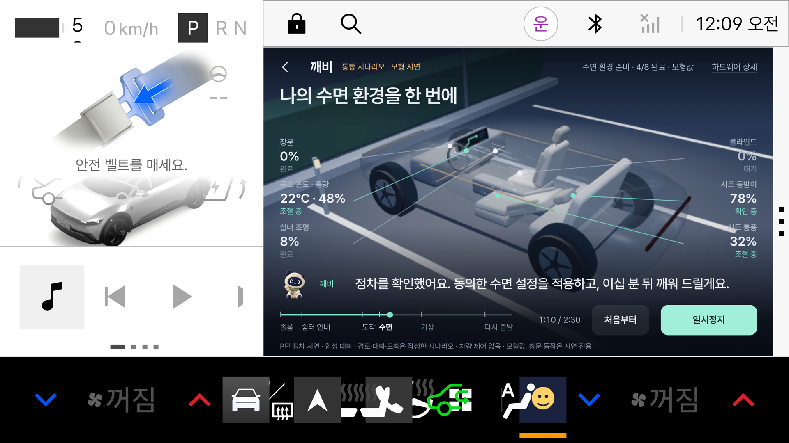
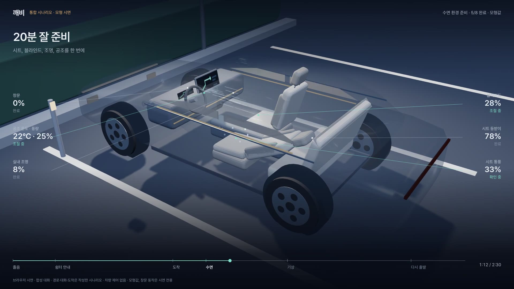
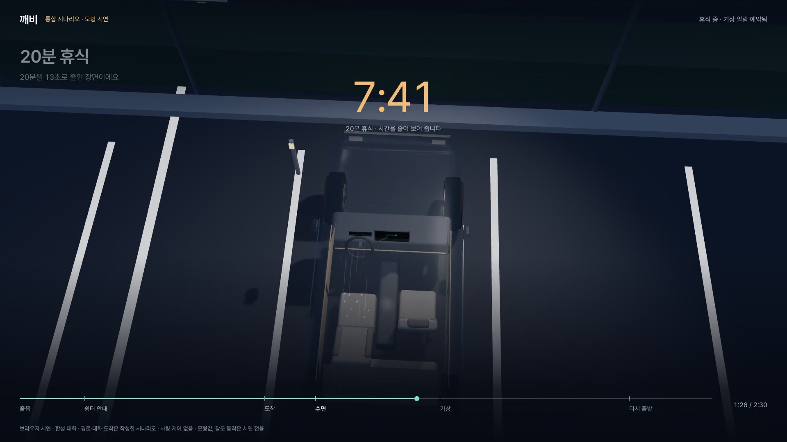

# 깨비

졸리다고 말하면 가장 가까운 졸음쉼터로 안내하고, 도착하면 차를 잠자리로 바꿔 20분 재운 뒤 깨워 주는 Pleos Connect 차량용 앱입니다.

2026 현대자동차그룹 차량용 앱 개발 공모전 출품작입니다.



## 시연

- 영상: [docs/kkaebi-journey-demo.mp4](docs/kkaebi-journey-demo.mp4) (2분 30초, 1080p, 음성 포함, [한국어 자막](docs/kkaebi-journey-demo.ko.srt))
- 영상은 앱에 내장된 통합 여정 시연 화면(`app/src/main/assets/web/demo/journey.html`)을 프레임 단위로 렌더한 것입니다. 같은 화면이 Pleos Connect 에뮬레이터의 release APK에서 실행됩니다(아래 첫 번째 그림).
- 경로, 대화, 운전자 응답, 하드웨어 진행 값은 작성한 시나리오이고 이 화면은 차량을 제어하지 않습니다. 목소리는 합성 음성이고, 차량은 대형 세단의 비례를 참고해 코드로 만든 모형입니다. 실제 SDK 실행 결과는 [ANDROID-VALIDATION.md](ANDROID-VALIDATION.md)에 따로 적었습니다.



| 쉼터 안내 | 수면 환경 준비 |
|---|---|
|  |  |
| 20분 휴식 | 다시 출발 |
|  |  |

## 실행 방법

APK는 [apk/kkaebi_release.apk](apk/kkaebi_release.apk)입니다. 버전 0.11.1 (12), 패키지 `ai.kkaebi.app.contest`.

```sh
adb -s <기기 시리얼> install -r apk/kkaebi_release.apk
adb -s <기기 시리얼> shell am start -n ai.kkaebi.app.contest/ai.kkaebi.app.MainActivity
```

1. 홈에서 휴식 시간(10·15·20·25·30분)을 고르고 **수면모드 준비**를 누릅니다.
2. 정차와 동의 항목을 확인하면 알람을 예약하고 시트·블라인드, 조명·통풍, 공조를 함께 준비합니다.
3. 알람이 울리면 **일어났어요 · 자동 복원**으로 이전 설정을 되돌립니다.
4. 홈의 **통합 여정 시연**에서 졸음 호출부터 재출발까지 150초 시나리오를 3D 장면으로 볼 수 있습니다. 이 화면은 차량을 제어하지 않습니다.

## 테스트 환경과 필요한 설정

- Pleos Connect 에뮬레이터: 42dot Automotive 시스템 이미지, Android 14 (API 34), arm64-v8a, revision 1
- 화면 규격: 2560 × 1440, 320 dpi, 가로
- 차량 제어는 기어 P, 속도 0에서만 동작합니다. 에뮬레이터의 차량 상태를 P단 정차로 맞춥니다.
- 알람에는 정확한 알람 권한과 알림 권한이 필요합니다. 에뮬레이터에서는 `adb shell appops set ai.kkaebi.app.contest SCHEDULE_EXACT_ALARM allow`로 허용했습니다.
- 앱은 화면 자산을 모두 내장하며 네트워크 없이 실행됩니다.

## 빌드

JDK 17, Android SDK(compileSdk 35, minSdk 28), Gradle 8.10.2.

```sh
echo "sdk.dir=$ANDROID_HOME" > local.properties
./gradlew :app:testDebugUnitTest :app:assembleDebug
node --test tests/rest-core.test.cjs tests/sleep-routine.test.cjs tests/cabin-scene.test.cjs tests/story-timeline.test.cjs
```

release 빌드에는 서명 키가 필요합니다. 키는 저장소에 넣지 않았습니다. 브라우저 테스트(`tests/*-browser.test.cjs`)는 Playwright가 필요합니다.

## 구조

| 경로 | 내용 |
|---|---|
| `app/src/main/assets/web/` | WebView로 띄우는 화면. HTML, CSS, JS, Pretendard 서체, 실내 모형 |
| `app/src/main/assets/web/demo/journey*.{html,css,js}` | three.js로 만든 통합 여정 시연. 차량·쉼터 모형은 코드로 생성 |
| `app/src/main/java/ai/kkaebi/app/rest/` | 수면 환경 준비와 복원. 안전 조건, 변경 전 값 저장, 병렬 실행 |
| `app/src/main/java/ai/kkaebi/app/alarm/` | 시스템 알람 예약과 재생 |
| `app/src/main/java/ai/kkaebi/app/vehicle/` | Pleos Vehicle SDK 연결 |
| `app/src/main/java/ai/kkaebi/app/navi/`, `speech/`, `gleo/` | NaviHelper, TTS·STT, Gleo AI 호출 처리 |
| `tests/` | 웹 로직과 화면 테스트 |

사용한 Pleos SDK: Vehicle 2.3.2, NaviHelper 3.0.5, TextToSpeech 3.3.1, SpeechToText 3.3.1, FusedLocation 1.1.3.

## 구현된 것과 남은 것

| 기능 | 상태 |
|---|---|
| 정차 확인, 알람 예약, 수면 환경 준비, 명시적 기상 뒤 복원 | 구현. 에뮬레이터에서 시트 통풍 적용과 복원을 확인. 알람 자연 만료는 이전 버전(0.8)에서 10분 예약으로 확인 |
| 공조 전원·풍량, 앰비언트 조명 | 구현. 에뮬레이터에서 쓰기 뒤 재조회가 실패해 결과 미확인 |
| 시트 등받이, 블라인드 이동 | 구현. 에뮬레이터에서는 위치 조회까지 확인. 실차 이동 미검증 |
| 졸음쉼터 안내 | 내비 검색 화면 요청까지 구현. 최근접 쉼터 계산과 경유지 추가는 개발 예정 |
| 주행 중 대화와 환기 | 시연 시나리오. 실제 연결은 개발 예정 |
| Gleo AI 호출 | 스키마와 Intent 처리 구현. 실제 발화 인식 미확인 |

원본 실행 로그와 녹화 원본은 용량이 커서 저장소에 넣지 않았습니다.

## 라이선스

서체 Pretendard는 SIL Open Font License 1.1, three.js(r149)는 MIT License를 따릅니다. [licenses/](licenses/) 참고.
