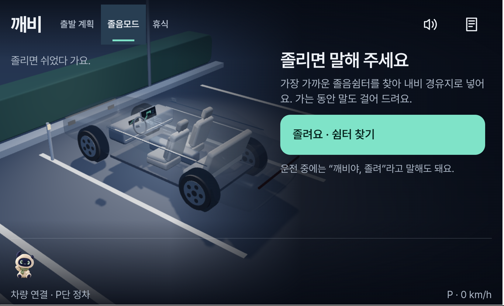
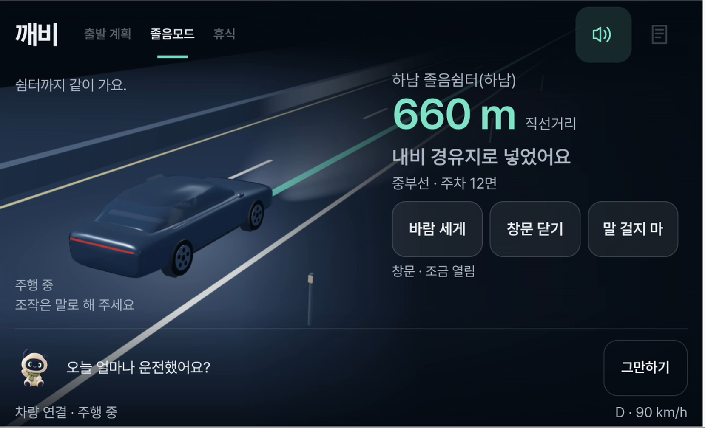
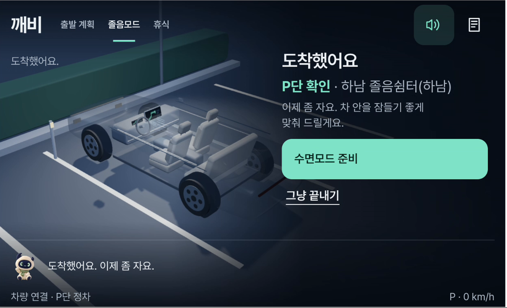
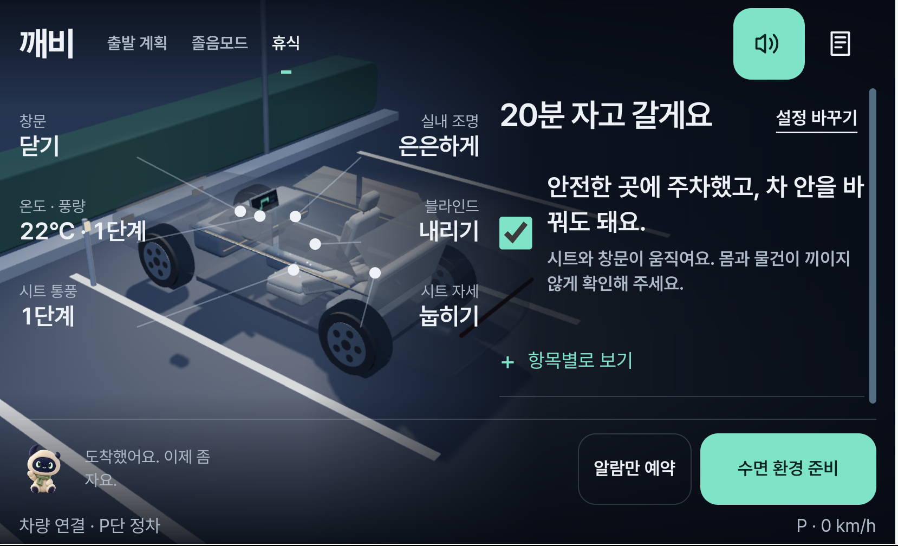
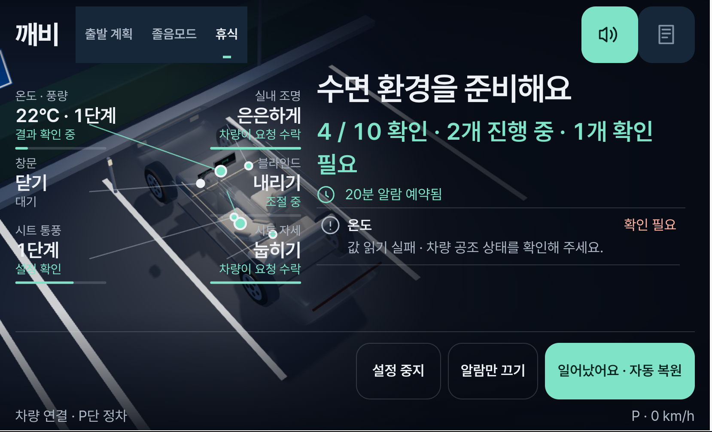
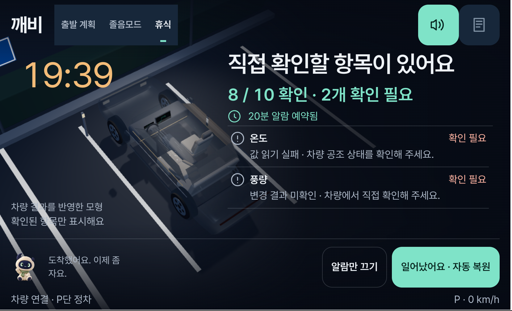
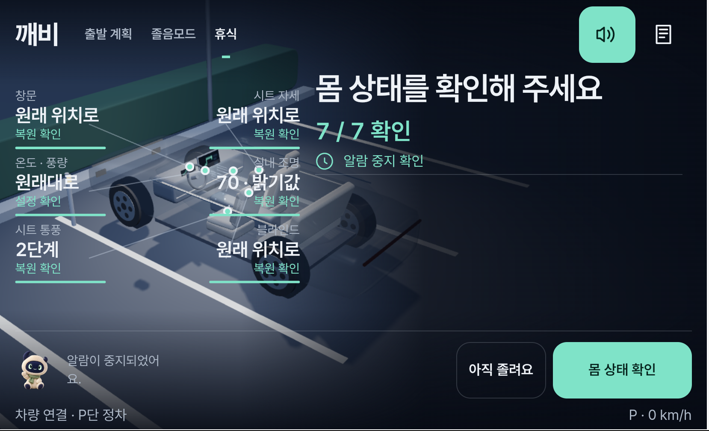
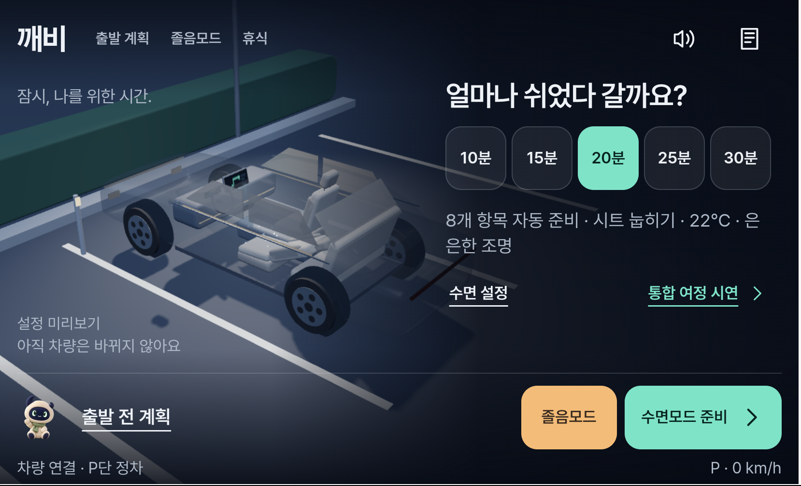

# 깨비

“졸려” 한마디에 검색 없이 가장 가까운 졸음쉼터로 안내하고 도착까지 말을 걸어 주며, 주차하면 차를 잠자리로 바꿔 재우고 깨워서 원래 가던 길로 이어 주는 Pleos Connect 차량용 앱입니다.

2026 현대자동차그룹 차량용 앱 개발 공모전 출품작입니다.


## 앱 화면

Pleos Connect 에뮬레이터에서 release APK를 실행해 찍은 화면입니다. 화면 전체가 three.js로 그린 차량 장면이고, 부품마다 조절 상태가 실시간으로 표시됩니다.

| 말 한마디로 시작 | 가장 가까운 쉼터로 |
|---|---|
|  |  |
| 도착하면 알아서 | 동의 한 번 |
|  |  |
| 조절되는 과정이 보인다 | 20분 휴식 |
|  |  |
| 원래대로, 원래 가던 길로 | 홈 |
|  |  |

에뮬레이터 위치를 경부선 죽암 졸음쉼터 2km 앞으로 두고 실행했습니다. 에뮬레이터 차량은 P단 고정이라 주행 화면은 없습니다.

## 시연 영상

- [docs/kkaebi-journey-demo.mp4](docs/kkaebi-journey-demo.mp4) (2분 30초, 1080p, 음성 포함, [한국어 자막](docs/kkaebi-journey-demo.ko.srt))
- 앱에 내장된 통합 여정 시연(`app/src/main/assets/web/demo/journey.html`)을 프레임 단위로 렌더한 것입니다. 경로, 대화, 운전자 응답, 하드웨어 진행 값은 작성한 시나리오이고 차량을 제어하지 않습니다. 목소리는 합성 음성이고, 차량은 대형 세단의 비례를 참고해 코드로 만든 모형입니다.

## 실행 방법

APK는 [apk/kkaebi_release.apk](apk/kkaebi_release.apk)입니다. 버전 0.14.0 (16), 패키지 `ai.kkaebi.app.contest`.

```sh
adb -s <기기 시리얼> install -r apk/kkaebi_release.apk
adb -s <기기 시리얼> shell am start -n ai.kkaebi.app.contest/ai.kkaebi.app.MainActivity
```

1. **졸음모드** 탭에서 **졸려요 · 쉼터 찾기**를 누르거나 "깨비야, 졸려"라고 말합니다. 가장 가까운 졸음쉼터와 남은 거리가 나오고 내비에 경유지를 요청합니다.
2. 가는 동안 **바람 세게**, **창문 조금 열기**, **말 걸지 마**를 고를 수 있습니다.
3. 쉼터 300m 안에서 P단에 놓으면 도착으로 바뀝니다. **수면모드 준비**에서 시간을 고르고 동의 항목을 확인하면 알람을 예약하고 시트·블라인드, 조명·통풍, 공조를 함께 준비합니다.
4. 알람이 울리면 **일어났어요 · 자동 복원**으로 이전 설정을 되돌립니다. 졸음모드로 쉼터에 왔다면 쉼터 경유지를 빼고 원래 목적지로 경로를 되돌립니다.
5. 홈의 **통합 여정 시연**에서 150초 시나리오를 볼 수 있습니다.

## 테스트 환경과 필요한 설정

- Pleos Connect 에뮬레이터: 42dot Automotive 시스템 이미지, Android 14 (API 34), arm64-v8a, revision 1
- 화면 규격: 2560 × 1440, 320 dpi, 가로
- 수면 준비의 차량 제어는 기어 P, 속도 0에서만 동작합니다.
- 권한: 위치(`pleos.car.permission.FUSED_LOCATION`), 경로 탐색(`NAVI_ROUTE_SEARCH`), 알림, 정확한 알람. 에뮬레이터에서는 아래처럼 허용했습니다.

```sh
adb shell pm grant ai.kkaebi.app.contest pleos.car.permission.FUSED_LOCATION
adb shell pm grant ai.kkaebi.app.contest pleos.car.permission.NAVI_ROUTE_SEARCH
adb shell pm grant ai.kkaebi.app.contest android.permission.POST_NOTIFICATIONS
adb shell appops set ai.kkaebi.app.contest SCHEDULE_EXACT_ALARM allow
adb emu geo fix 127.405 36.436   # 죽암 졸음쉼터 2km 앞
```

- 앱은 화면 자산을 모두 내장하며 네트워크 없이 실행됩니다.

## 빌드

JDK 17, Android SDK(compileSdk 35, minSdk 28), Gradle 8.10.2.

```sh
echo "sdk.dir=$ANDROID_HOME" > local.properties
./gradlew :app:testDebugUnitTest :app:assembleDebug
node --test tests/rest-core.test.cjs tests/sleep-routine.test.cjs tests/cabin-scene.test.cjs tests/story-timeline.test.cjs
```

release 빌드에는 서명 키가 필요합니다. 키는 저장소에 넣지 않았습니다. 브라우저 테스트(`tests/*-browser.test.cjs`)는 Playwright가 필요합니다.

## 구조

| 경로 | 내용 |
|---|---|
| `app/src/main/assets/web/` | WebView로 띄우는 화면. `cabin3d.js`와 `stage-labels.js`가 three.js 차량 장면과 부품 라벨을 그림 |
| `app/src/main/assets/web/demo/journey*.{html,css,js}` | three.js로 만든 통합 여정 시연. 차량·쉼터 모형은 코드로 생성 |
| `app/src/main/java/ai/kkaebi/app/rest/` | 수면 환경 준비와 복원. 안전 조건, 변경 전 값 저장, 병렬 실행 |
| `app/src/main/java/ai/kkaebi/app/alarm/` | 시스템 알람 예약과 재생 |
| `app/src/main/java/ai/kkaebi/app/vehicle/` | Pleos Vehicle SDK 연결 |
| `app/src/main/java/ai/kkaebi/app/navi/` | 졸음쉼터 선택과 안내 상태(`DrowsyGuide`), FusedLocation·NaviHelper 연결 |
| `app/src/main/java/ai/kkaebi/app/speech/`, `gleo/` | TTS·STT, Gleo AI 호출 처리 |
| `tests/` | 웹 로직과 화면 테스트 |

사용한 Pleos SDK: Vehicle 2.3.2, NaviHelper 3.0.5, TextToSpeech 3.3.1, SpeechToText 3.3.1, FusedLocation 1.1.3.

## 구현된 것과 남은 것

에뮬레이터는 일부 속성에 대해 쓰기를 수락하고도 바뀐 값을 돌려주지 않습니다. 앱은 "설정 확인"(재조회 일치)과 "차량이 요청 수락"(SDK 성공 응답, 재조회 불일치)을 구분해 표시합니다.

| 기능 | 에뮬레이터 결과 |
|---|---|
| 졸음쉼터 선택, 거리 갱신, 도착 판정 | 확인. 경유지 요청이 내비에 전달된 것은 로그로 확인, 반영 확인 이벤트는 받지 못함. 쉼터 목록은 시범 데이터 10곳 |
| 창문 닫기, 시트 통풍 | 설정 확인 |
| 공조 전원, 실내 조명, 시트 등받이, 블라인드 | 차량이 요청 수락. 값 재조회는 이전 값 그대로 |
| 온도, 풍량 | 실패. 에뮬레이터에서 공조가 실제로 켜지지 않아 PropertyNotAvailable |
| 기상 뒤 복원 | 변경한 7개 항목 모두 원래 값 확인 |
| 원래 경로 복귀 | 구현. 에뮬레이터에 목적지가 없어 "목적지 없음" 분기까지만 확인 |
| 주행 중 동행(음성), 주행 중 환기 | 구현. 음성 출력과 시트 통풍 확인. 에뮬레이터가 P단 고정이라 주행 상태는 미확인 |
| 잘 때 듣는 소리 | 구현. 빗소리·물소리·파도·명상 음을 앱이 합성(외부 음원 없음). 설정에서 선택 확인 |
| Gleo AI 호출 | 스키마와 Intent 처리 구현. 실제 발화 인식 미확인 |

## 라이선스

서체 Pretendard는 SIL Open Font License 1.1, three.js(r149)는 MIT License를 따릅니다. [licenses/](licenses/) 참고.
